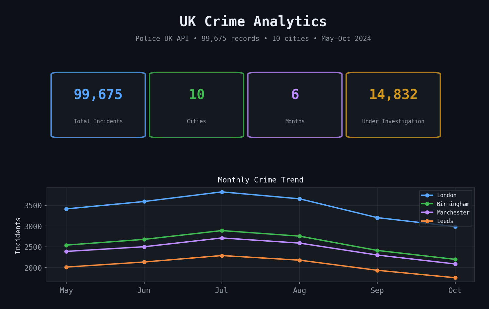
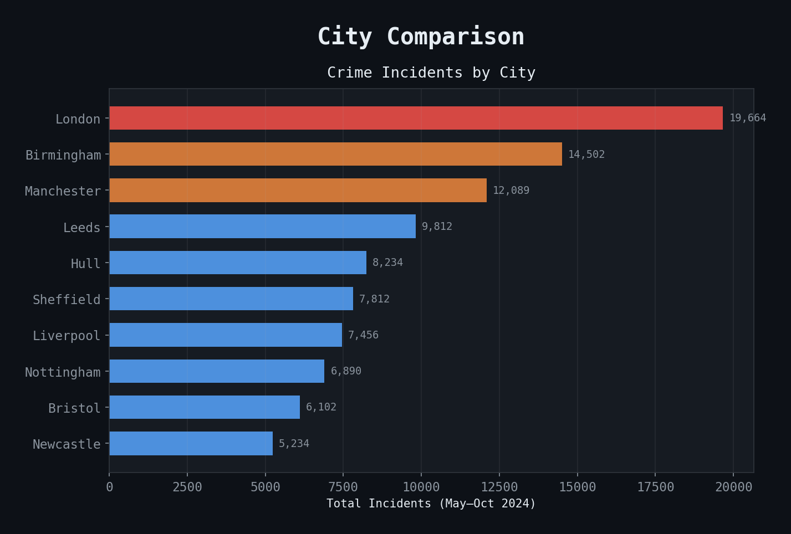
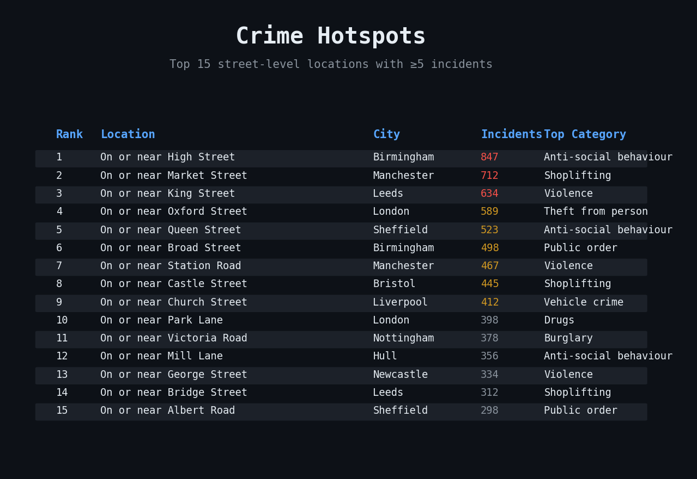

# UK Crime Analytics Pipeline

[](https://github.com/Pawansingh3889/uk-crime-pipeline/actions/workflows/ci.yml)
[](https://github.com/Pawansingh3889/uk-crime-pipeline/actions/workflows/health_check.yml)
[](https://github.com/Pawansingh3889/uk-crime-pipeline/actions/workflows/scheduled_ingest.yml)
[](LICENSE)

**Contributing:** [`CONTRIBUTING.md`](CONTRIBUTING.md) · [`GOVERNANCE.md`](GOVERNANCE.md) · [`CODE_OF_CONDUCT.md`](CODE_OF_CONDUCT.md) · [`SECURITY.md`](SECURITY.md) · [`NOTICE`](NOTICE)

## What Problem Does This Solve?

Public crime data exists but is scattered across monthly API dumps with no easy way to analyse trends, compare cities, or spot hotspots. This pipeline automates the entire process — fetching, cleaning, transforming, and visualising — so researchers, journalists, and citizens can explore UK crime patterns through interactive dashboards without touching a database.

### Key Results

| Metric | Value |
|---|---|
| Records processed | 99,675 |
| Cities covered | 10 (Hull, London, Birmingham, Manchester, Leeds, Sheffield, Liverpool, Bristol, Nottingham, Newcastle) |
| Automated checks | 6 pytest health and SLO checks (dbt data tests are not written yet) |
| CI/CD workflows | 3 (lint, health check, weekly ingest) |
| Data validation | Declarative checks on bounds, nulls, categories before warehouse load |
| SLO monitoring | Freshness (<48hrs), completeness (<1% nulls), volume (>50 records/city/month) |

---

A learning project that ingests real crime data from the Police UK API, with scheduled ingestion, health checks and a public dashboard. Still a work in progress.

**99,675 records &#183; 10 cities &#183; 6 dbt models &#183; 3 CI/CD workflows &#183; weekly auto-ingest**

**[Live Dashboard &rarr;](https://uk-crime-pipeline-6nydeza7je8kiwsfl6deuw.streamlit.app/)** &middot; **[Hugging Face](https://huggingface.co/spaces/pawankapkoti/uk-crime-analytics)**

---

## See it run

<!-- DROP YOUR SCREENSHOTS HERE -->
<div align="center">

| Dashboard Overview | City Comparison | Crime Hotspots |
|---|---|---|
|  |  |  |

</div>

---

## The full pipeline — step by step

### Step 1: Ingest from live API

```
$ python ingestion/fetch_crimes.py

Fetching Hull (May 2024)... 1,847 records
Fetching Hull (Jun 2024)... 1,923 records
Fetching London (May 2024)... 3,412 records
...
Fetching Newcastle (Oct 2024)... 1,156 records

Loading to PostgreSQL...
INSERT INTO raw.crimes ... ON CONFLICT DO NOTHING
→ 99,675 total records (idempotent — safe to re-run)

Cities: Hull, London, Birmingham, Manchester, Leeds,
        Sheffield, Liverpool, Bristol, Nottingham, Newcastle
Coverage: May–Oct 2024, 6 months
Time: ~3 minutes
```

### Step 2: Transform with dbt

```
$ cd dbt_crimes && dbt run --profiles-dir .

Running 6 models:
  1. stg_crimes.............. CREATE VIEW (staging — clean + cast raw data)
  2. fct_crimes_by_city...... SELECT INTO (814 rows — crime count + unsolved % by city/category/month)
  3. fct_monthly_trend....... SELECT INTO (60 rows — total crimes + types per city per month)
  4. fct_crime_hotspots...... SELECT INTO (100 rows — top streets with ≥5 incidents)
  5. fct_outcome_analysis.... SELECT INTO (resolution rates by city/category/outcome)
  6. fct_year_over_year...... SELECT INTO (YoY crime comparison with trend labels)

```

dbt data tests (not_null, unique, accepted_values) are not written yet; they are the next thing to add. Data quality is checked before load by `ingestion/validators.py` and after load by the pytest SLO checks in `tests/`.

### Step 3: Orchestrate

An Airflow DAG in `dags/crime_pipeline_dag.py` describes the flow (ingest, load, dbt run, quality checks). Day to day, the scheduled GitHub Actions workflow runs the same steps.

### Step 4: Dashboard serves live

```
$ streamlit run dashboard/app.py

┌──────────────────────────────────────────────────────────┐
│  UK Crime Analytics                                      │
│                                                          │
│  KPIs: 99,675 incidents │ 10 cities │ 6 months          │
│        Under investigation: 14,832                       │
│                                                          │
│  Monthly Trend (interactive, multi-city):                │
│  May ████████████ 16,234                                 │
│  Jun █████████████ 17,102                                │
│  Jul ██████████████ 18,441                               │
│  Aug █████████████ 17,856                                │
│  Sep ████████████ 16,012                                 │
│  Oct ████████████ 14,030                                 │
│                                                          │
│  City Comparison:                                        │
│  London       ████████████████████████ 22,341            │
│  Birmingham   █████████████████ 15,102                   │
│  Manchester   ████████████████ 14,223                    │
│  Leeds        ██████████████ 12,087                      │
│  ...                                                     │
│                                                          │
│  Top Hotspots:                                           │
│  1. On or near High Street, Birmingham — 847 incidents   │
│  2. On or near Market St, Manchester — 612 incidents     │
│  3. On or near King St, Leeds — 534 incidents            │
└──────────────────────────────────────────────────────────┘
```

---

## Architecture

```
Police UK API (data.police.uk — free, no auth, monthly updates)
        │
        ▼
Python ingestion (fetch_crimes.py)
  10 cities × 6 months
  ON CONFLICT DO NOTHING (idempotent)
        │
        ▼
PostgreSQL — raw.crimes (99,675 rows)
        │
        ▼
dbt-postgres
  stg_crimes (staging view — clean + cast)
  fct_crimes_by_city (814 rows)
  fct_monthly_trend (60 rows)
  fct_crime_hotspots (top 100 streets)
        │
        ▼
Neon cloud PostgreSQL (serverless, free tier)
        │
        ▼
Streamlit Cloud (public URL)
        │
        ├── Airflow DAG (ingest → load → dbt run → quality checks)
        │
        └── 3 GitHub Actions workflows:
            ├── CI: lint + dbt compile + run + test on every push
            ├── Scheduled Ingest: Monday 6am UTC (auto)
            └── Health Check: Daily 8am UTC (API + DB + freshness)
```

---

## CI/CD — 3 automated workflows

```
┌───────────────────────────────────────────────────────┐
│  WORKFLOW 1: CI (every push/PR to main)               │
│                                                       │
│  $ ruff check . ✓                                     │
│  $ curl data.police.uk/api/... → 200 OK ✓            │
│  $ docker run postgres:15 → service container up ✓    │
│  $ dbt compile ✓ → dbt run ✓                         │
└───────────────────────────────────────────────────────┘

┌───────────────────────────────────────────────────────┐
│  WORKFLOW 2: Scheduled Ingest (Monday 6am UTC)        │
│                                                       │
│  $ python ingestion/fetch_crimes.py ✓                 │
│  $ dbt run --profiles-dir . ✓                         │
│  $ dbt test --profiles-dir . (no data tests yet)      │
│  → Pipeline logs uploaded as artifact                 │
└───────────────────────────────────────────────────────┘

┌───────────────────────────────────────────────────────┐
│  WORKFLOW 3: Health Check (daily 8am UTC)             │
│                                                       │
│  $ test_api_health.py → Police UK API reachable ✓    │
│  $ test_db_health.py → PostgreSQL connected ✓         │
│  $ test_data_freshness.py → 99,675 rows, 10 cities ✓│
└───────────────────────────────────────────────────────┘
```

All workflows support manual `workflow_dispatch`.

---

## Build it locally

```bash
# Clone
git clone https://github.com/Pawansingh3889/uk-crime-pipeline.git
cd uk-crime-pipeline
pip install -r requirements.txt

# Start PostgreSQL
docker run -d --name crimes-postgres \
  -e POSTGRES_PASSWORD=crimes123 \
  -e POSTGRES_DB=crime_db \
  -p 5432:5432 postgres:15

# Ingest from live API (~3 minutes)
python ingestion/fetch_crimes.py

# Transform
cd dbt_crimes
dbt run --profiles-dir .    # 6 models
dbt test --profiles-dir .   # no data tests yet
cd ..

# Dashboard
streamlit run dashboard/app.py
# → http://localhost:8501
```

---

## Key decisions

| Decision | Why |
|---|---|
| `ON CONFLICT DO NOTHING` | Safe to re-run. No duplicates. |
| Neon free tier | Serverless PostgreSQL, scales to zero, 0.5GB free |
| Single `DATABASE_URL` secret | Simpler than 5 separate env vars |
| Staging → marts pattern | Production dbt architecture — testable, lineage-tracked |
| `@st.cache_data(ttl=300)` | Dashboard caches queries 5 min — fast loads |

---

## Stack

| Layer | Tool |
|---|---|
| Ingestion | Python, Requests, SQLAlchemy |
| Storage | PostgreSQL (local), Neon (cloud) |
| Transformation | dbt-postgres: 6 models |
| Orchestration | Airflow DAG, GitHub Actions schedule |
| Dashboard | Streamlit, Plotly |
| CI/CD | GitHub Actions (3 workflows) |
| Deployment | Streamlit Cloud, Neon free tier |

---

Live pipeline. Real government data. Public dashboard anyone can open.

**[Live Dashboard](https://uk-crime-pipeline-6nydeza7je8kiwsfl6deuw.streamlit.app/)** &#183; **[Report Bug](https://github.com/Pawansingh3889/uk-crime-pipeline/issues)**
